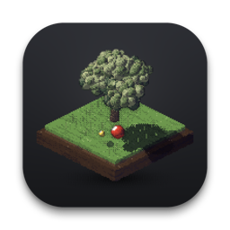

<p align="center">
  
</p>

<h1 align="center">Hakoniwa (箱庭)</h1>

<p align="center">
  <strong>原生 macOS 3D 像素艺术动态壁纸与交互沙盘</strong><br>
  <em>Native macOS 3D Pixel Art Live Wallpaper & Interactive Desktop Toy</em>
</p>

<p align="center">
  
  
  
  
  
</p>

---

## 简介 (Overview)

**Hakoniwa (箱庭)** 是一款为 macOS 深度定制的 3D 像素艺术沙盘与桌面玩具。它既可以作为一个小巧雅致的独立窗口应用运行，也能沉浸式化身为 macOS 桌面底层动态壁纸，在不影响日常生产力工作的同时，为你的桌面增添一份复古与生机。

项目摒弃了重量级三方商业游戏引擎，采用纯原生 **Swift + AppKit / SwiftUI** 与 **SIMD** 硬件加速，自研轻量级 30° 等轴测软光栅（Software Rasterizer）。兼具高保真复古像素美感与极低的 CPU、内存和电池能耗。

---

## 核心特性 (Features)

### 3D 像素软光栅引擎 (PixelEngine)
- **等轴测深度渲染**：支持 30° 正交透视投影、浮点深度缓冲（Z-Buffer）与像素级几何遮挡。
- **复古色彩算法**：内置 Bayer 4×4 矩阵有序抖动算法，配合冷暖色相偏移渐变（Shadows Drift to Violet, Lights Drift to Warm Yellow）。
- **动态物理表现**：实时投射阴影、多层地面贴花融合、程序化风力扰动与树叶草丛摇曳。

### 五大独立交互场景 (Scenes)
1. **经典法式滚球 (Balote)**：具备完整的 3D 重力抛物线弹道、地面减速摩擦、球体弹性碰撞与自主评估投掷轨迹的智能 AI 对手。
2. **禅意盆栽 (Zen Bonsai)**：枯山水庭院与生长的黑松盆栽。打字带动添水竹筒（鹿威）注水翻转叩石，唤醒小憩的柴犬摇尾，伴随落樱与翩翩彩蝶。
3. **微缩建造 (Monument Builder)**：浮岛工坊营造日记。日常敲击键盘为工坊添砖加瓦，经历铺设基石、立柱挑梁、砌筑砖墙、搭设斜顶与点燃烟囱炊烟的建造循环。
4. **弹珠连击 (Pachinko)**：复古日式倾斜弹珠台。工作打字自动为弹仓充能蓄弹，一键或点击释放多球倾泻，穿梭于黄铜撞针之间触发高分漏槽。
5. **浮岛鱼塘 (Aquarium Pond)**：清澈通透的下沉式庭院水池。五尾不同花色的灵动锦鲤（红白、大正、昭和、黄金、白金）在池底细砂与卵石间游曳，键盘打字自动投撒鱼粮，伴随波光与水花涟漪。

### 敲击感知与打字互动 (Keystroke Activity)
- 内置低开销的活动监听机制，无需前台聚焦箱庭窗口。
- 在任意软件中日常编码、写作或聊天时，箱庭均能感知打字节奏并实时转化为场景反馈（注水、筑砖、撒粮、蓄弹），让日常打字化为箱庭世界的生机源泉。

### 原生 macOS 动态桌面壁纸
- **零干扰安全层级**：壁纸窗口工作于系统 `kCGDesktopWindowLevel`，处于桌面壁纸与桌面图标之间，绝不遮挡、截断任何正常软件窗口。
- **桌面点击交互**：支持在 Finder 前台点击桌面空白处直接操控箱庭场景（投球、浇水、筑砖、倾泻、投喂），无需切换窗口。
- **低功耗感知**：全屏软件覆盖或显示器休眠时自动挂起渲染循环，极致省电。

### 菜单栏常驻 (Menu Bar Extra)
- 快速切换当前箱庭场景。
- 动态桌面壁纸开关与一键暂停/恢复。
- 一键静音与快速唤起偏好设置。

### 纯程序化音效合成 (Procedural Audio)
- 基于 macOS 原生 `AVAudioEngine` 与 `AVAudioPCMBuffer`，在内存中动态生成方波、正弦波与三角波。
- 零外部音频文件依赖，水滴滴答、竹筒叩石、工坊锻打、清脆撞针、水花水泡等音效均由物理公式即时合成，内置防重叠节流控制。

### 丰富平滑的偏好设置
- **渲染帧率**：支持 30 FPS（极致节能）、60 FPS（流畅平衡）与 120 FPS（ProMotion 高刷）。
- **背景风格**：支持深浅纯色底色自适应或完全透明背景（箱庭悬浮于当前桌面壁纸之上）。
- **画面缩放**：50% ~ 120% 无级平滑自由缩放，随时重置推荐比例。

---

## 玩法与场景操作 (Controls)

| 场景 | 键盘打字联动 | 鼠标 / 空格交互 |
| :--- | :--- | :--- |
| **经典法式滚球** | 实时环境感知 | 拖拽红球蓄力投掷，空格快捷发球，按距离黄色目标球（Jack）计分 |
| **禅意盆栽** | 打字注水并促进黑松生长 | 鼠标点击或按空格手动浇水，惊醒柴犬摇尾互动 |
| **微缩建造** | 打字推进砖石与木梁建造 | 鼠标点击或按空格手动砌筑砖块与加速施工 |
| **弹珠连击** | 打字自动为弹仓充能弹珠 | 鼠标点击或按空格拉动弹簧杆，倾泻弹珠连击撞针 |
| **浮岛鱼塘** | 打字自动向水面撒落鱼粮 | 鼠标点击水面投放鱼食，激起涟漪吸引锦鲤觅食 |

---

## 项目结构 (Project Structure)

```text
Hakoniwa/
├── Hakoniwa/
│   ├── Core/
│   │   ├── PixelEngine.swift         # 3D 像素软光栅透视渲染引擎
│   │   ├── MathUtils.swift           # 插值、缓动与噪声数学工具
│   │   ├── Scene.swift               # 箱庭场景抽象协议与接口
│   │   ├── KeystrokeMonitor.swift    # 键盘打字活动与节奏监听器
│   │   ├── AppSettings.swift         # 用户持久化配置与管理
│   │   └── HakoniwaAppModel.swift    # 状态分发与渲染循环总控（线程锁保护）
│   ├── Scenes/
│   │   ├── BaloteScene.swift         # 法式滚球场景逻辑、物理模拟与 AI
│   │   ├── ZenBonsaiScene.swift      # 禅意盆栽庭院场景（鹿威竹筒与柴犬）
│   │   ├── MonumentBuilderScene.swift# 微缩工坊建造日记场景
│   │   ├── PachinkoScene.swift       # 复古日式弹珠台连击场景
│   │   └── AquariumPondScene.swift   # 浮岛锦鲤水池场景
│   ├── Wallpaper/
│   │   ├── WallpaperManager.swift    # 原生桌面底层壁纸窗口管理
│   │   └── DesktopEventMonitor.swift # 桌面空白处事件监听
│   ├── Render/
│   │   └── PixelCanvasNSView.swift   # 高性能 Direct-to-Bitmap 渲染画布
│   ├── Audio/
│   │   └── SoundManager.swift        # 程序化合成器音效管理器（带防叠节流）
│   ├── ContentView.swift             # 独立主窗口及交互 HUD
│   ├── SettingsView.swift            # 偏好设置面板 (TabView)
│   └── HakoniwaApp.swift             # 应用入口与 MenuBarExtra
├── Scripts/
│   ├── package_dmg.sh                # 全自动 DMG 打包与视觉对齐脚本
│   ├── generate_dmg_background.swift # PixelEngine 同款 3D 像素 DMG 背景生成器
│   └── generate_icon.swift           # 原生全尺寸 ICNS 图标生成脚本
├── LICENSE                           # MIT 开源许可证（包含第三方致谢声明）
└── README.md
```

---

## 构建与运行 (Build & Run)

### 环境要求
- macOS 14.0 (Sonoma) 或更高版本
- Xcode 15.0+
- Swift 5.9+

### 1. 本地编译运行
克隆仓库后直接通过 Xcode 打开项目：
```bash
git clone https://github.com/Cicada000/Hakoniwa.git
cd Hakoniwa
open Hakoniwa.xcodeproj
```
选择 `Hakoniwa` Scheme，点击 **Run** (⌘R) 即可启动。

### 2. 构建 DMG 发布镜像
项目内置全套自动化打包脚本，会自动利用 `PixelEngine` 在编译期实时光栅化渲染出同款等轴测 3D 像素全景安装背景，并自动配置 Finder 布局：
```bash
chmod +x Scripts/package_dmg.sh
./Scripts/package_dmg.sh
```
构建完成后可在 `dist/Hakoniwa-v1.0.dmg` 找到精美的安装镜像。

---

## 开源协议与致谢 (License & Acknowledgements)

本项目遵循 [MIT License](LICENSE) 开源协议。

### 致谢 (Acknowledgements)

Hakoniwa 的 3D 像素正交投影渲染架构 (`PixelEngine.swift`)、Balote 法式滚球场景算法与物理规则 (`BaloteScene.swift`)，以及程序化音频合成参数 (`SoundManager.swift`) 参考并移植自优秀的前端开源项目 **[pixel-plays](https://github.com/amirmushichge/pixel-plays)**。

- **Upstream 项目**：[pixel-plays](https://github.com/amirmushichge/pixel-plays)
- **原作者**：[Amir Mushich](https://github.com/amirmushichge)
- **原协议**：MIT License

特此对原作者 **Amir Mushich** 富有创意的像素渲染算法与优雅的设计表达诚挚敬意与感谢！原项目完整的 MIT 版权声明已妥善保留于本仓库的 [LICENSE](LICENSE) 文件中。
